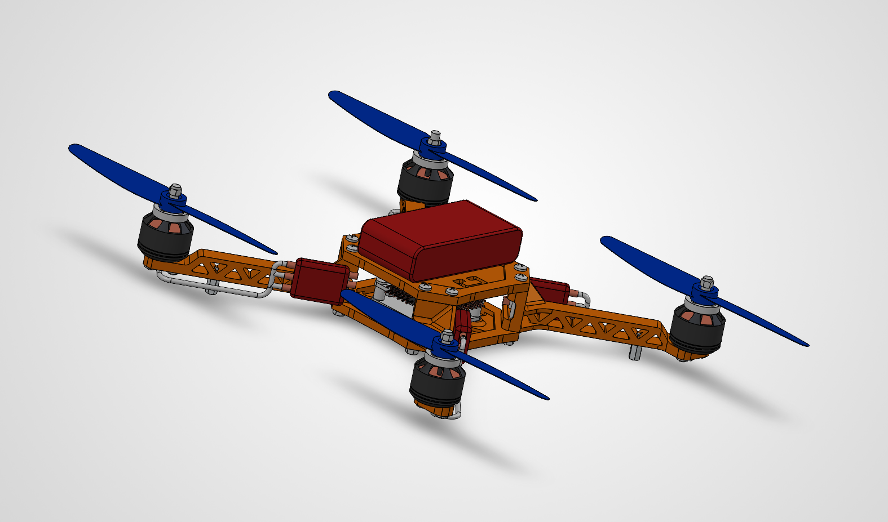

# Quadcopter Drone Mechanical CAD Assembly

Custom 3D quadcopter drone designed, modeled, and assembled in **SOLIDWORKS**. The design integrates truss-reinforced lightweight arms, vibration-isolated electronic mounts, and a multi-tier central chassis for avionics and power distribution.

---

## Visualizations

### Assembled Isometric View

  

### Exploded View & Kinematic Assembly

  

---

## Subsystems & Architecture

* **Structural Airframe:**
  * Modular multi-plate central chassis housing the flight controller stack and power distribution.
  * Webbed truss motor arms optimized for high torsional stiffness while minimizing overall airframe weight.
  * Fastened standoffs and hardware interface points providing clearance for wire routing.

* **Propulsion & Actuation:**
  * 4x Brushless DC outrunner motors with threaded collet prop adapters.
  * Matched dual-blade aerodynamic propellers.
  * Individual arm-mounted Electronic Speed Controller (ESC) bays with direct motor lead routing.

* **Avionics & Power Integration:**
  * Top-mounted modular battery tray designed for LiPo balance and center-of-gravity (CG) stability.
  * Central internal bay for flight controller board mounting, receiver, and sensor routing.

---

## CAD Modeling Details

* **Software:** Dassault Systèmes SOLIDWORKS
* **Techniques Used:** Parametric Part Modeling, Bottom-Up Assembly, Mechanical Mates, Interference Detection, Exploded View Animations, PhotoView 360 / Visualize Rendering.
* **Deliverables:** High-resolution renders, exploded assembly animations, and exported neutral CAD formats (`.STEP`).
